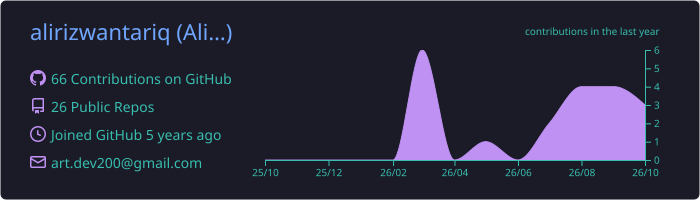
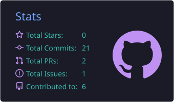
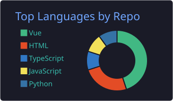
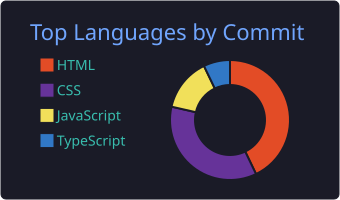
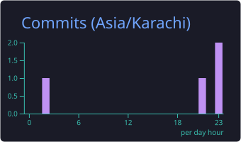

<!-- ═══════════════════════════════════════════════════════════════ -->
<h1 align="center">Hi, I'm Ali Rizwan Tariq</h1>

  

---

### 🧠 I build systems that decide *who to trust.*

Since 2022, my work has lived where a wrong answer costs real money — **fraud detection**, **identity verification (KYC/KYB/AML)**, and **vision models small enough to run on a device in the field**. I build the model *and* the portal it's watched from, so I find the gap between "it works in the notebook" and "it works at 3am, with nobody looking."

Currently at **FAMS by Falkenherz** 🇦🇪, turning raw telematics into decisions the device makes itself.

| 🎯 **98%** | ⚡ **+150%** | 📷 **95%** | 🛡️ **−70%** |
|:---:|:---:|:---:|:---:|
| **precision** — AI fraud detection (Shufti) | **ingestion speed** — real-time pipelines rebuilt (Shufti) | **accuracy on-device** — Vision AI on Jetson / RPi (FAMS) | **fewer vulnerabilities** — security audit (Facia) |

---

## 💼 Experience

| Company | Role | Period | Highlights |
|---|---|---|---|
| 🛰️ **FAMS by Falkenherz** | Full Stack Software Engineer, AI/ML | `2026 · Dubaï (Remote)` | ViT/YOLO deployed on **Jetson & Raspberry Pi** · NestJS admin portal · M2X telematics |
| 🕵️ **Shufti** | Data Scientist | `2023–2025 · UK (Remote)` | **98% precision** anomaly detection · Zero Trust adaptive auth · **+150%** ingestion speed |
| 🪪 **Facia** | Full Stack Engineer | `2023–2024 · Lahore` | Biometric KYC frontend lead · patched camera stream injection hole · **−70%** vulns |
| 🧩 **Programmers Force** | SE II → Full Stack & AI/ML | `2022–2025 · Lahore` | ML-powered auth system (end-to-end) · enterprise KYB/AML platforms · frontend team lead |

---

## 🚀 Flagship Projects

> Most production work sits behind compliance-company logins, so I describe the problems and outcomes:

1. **🛰️ Vision AI that runs where there's no cloud** — Tuned ViT + YOLO detectors onto NVIDIA Jetson & Raspberry Pi; built a NestJS portal for model monitoring & lifecycle. *→ 95% detection accuracy on-device.*
2. **🧠 Fraud detection by behavior, not claims** — Behavioral anomaly models + Zero Trust adaptive authentication APIs, risk scored per session. *→ 98% precision in production.*
3. **⚡ Threat detection fast enough to matter** — Rebuilt ingestion path for throughput; low-latency detection over current state, not stale batches. *→ +150% ingestion speed.*
4. **🕳️ Closed a camera stream injection hole in a live KYC pipeline** — Found the media-spoofing path by auditing as an attacker would, patched pre-production. *→ −70% vulnerabilities.*
5. **📜 Regulation → software people can operate** — Enterprise KYB/AML platforms; merged overlapping frontend/backend into shared modules; led the frontend team.

### 📦 Selected open-source repos

<!-- Note: repo cards are hand-built badges, so they never go down like the shared stats services -->

| 📄 [**PDF-Editor-OCR**](https://github.com/alirizwantariq/PDF-Editor-OCR) | 📥 [**grab-watch-download**](https://github.com/alirizwantariq/grab-watch-download) |
|:---|:---|
| Edit PDFs with OCR — character & font recognition | Media grabber / downloader tool |
|  |  |
| 🩺 [**techcare**](https://github.com/alirizwantariq/techcare) | 📰 [**news-api-aggregator**](https://github.com/alirizwantariq/News_Api) |
| UI for a patient management system | News aggregation API service |
|  |  |

---

## 🛠️ Tech Stack

**Languages**

  
  
  
  

**🤖 AI / ML & Vision**

  
  
  
  
  
  

**Backend & Frontend**

  
  
  
  
  

**🛡️ Security & Infrastructure**

  
  
  
  
  

---

## 📊 GitHub Stats & Streaks

<!-- Stat cards are committed as SVG files in this repo (profile-summary-card-output/),
     refreshed weekly by .github/workflows/summary-cards.yml — immune to the rate
     limits that break the shared github-readme-stats service. -->

  
  

  
  
  

  

  

---

### 📫 Let's talk

**📍 Lahore, Pakistan · UTC+5 — working remotely with teams in UK & UAE**

Open to **full-time roles, freelance & AI/ML consulting**

